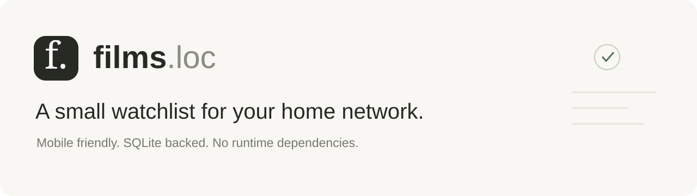
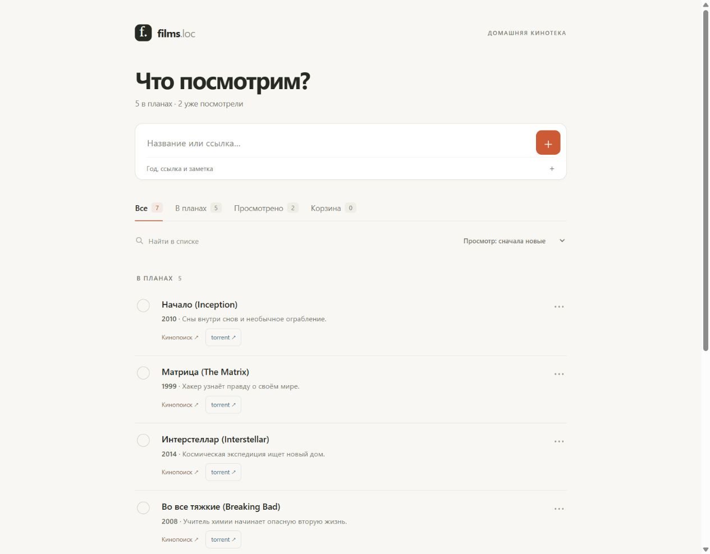
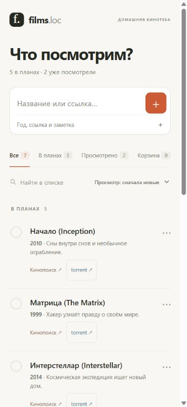
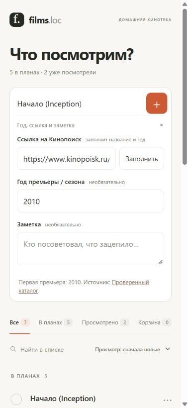
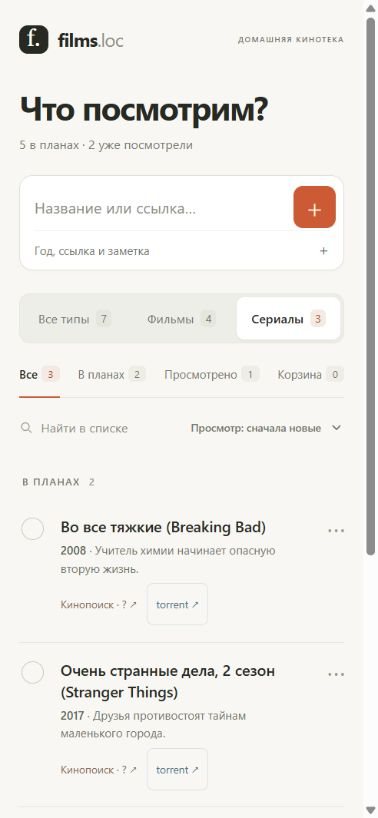
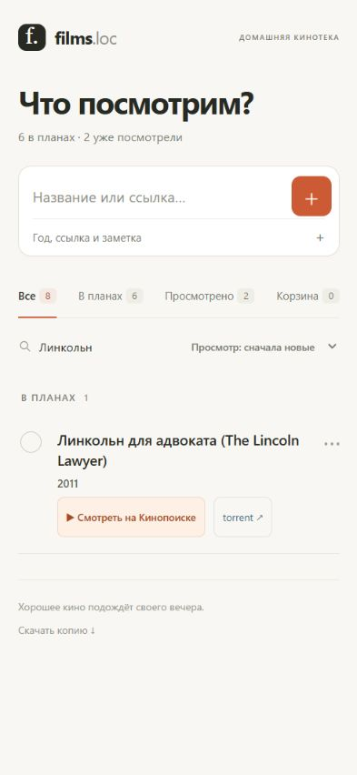

<p align="center">
  
</p>

<p align="center">
  <a href="https://github.com/Vomblr/films-loc/actions/workflows/test.yml"></a>
  
  
  
</p>

**A personal movie and series watchlist that lives on your home server.** Add a title or paste a Kinopoisk link, keep a short note, and mark it watched when the evening is over. Planned titles stay at the top; watched titles keep their viewing dates.

The interface is intentionally small: one page, readable text, generous touch targets, and no poster grid. The UI is currently **in Russian**; this documentation is in English.

<p align="center">
  <a href="#quick-start">Quick start</a> ·
  <a href="#screenshots">Screenshots</a> ·
  <a href="docs/self-hosting.md">Self-hosting</a> ·
  <a href="docs/architecture.md">Architecture & API</a> ·
  <a href="docs/data-and-privacy.md">Data & privacy</a>
</p>

## At a glance

| Capability | What it does |
| --- | --- |
| Fast entry | Add a title immediately, or expand the year, Kinopoisk link, and note fields. |
| Metadata lookup | A Kinopoisk card ID resolves to Russian and original titles and a release year through a small reviewed cache or Wikidata. No API key. |
| Watch on Kinopoisk | Checks the public streaming catalogue when a link is added. A play button means confirmed availability; unavailable and unknown results stay distinct. |
| Sensible years | Films use the earliest known premiere; series use the first broadcast year; selected seasons use their own release year. |
| Watch history | Stores the viewing date separately from the timestamp when the watched mark was added. Unknown historical dates can stay empty. |
| Search & sorting | Combine All / Movies / Series with watch status and search. Counters reflect the current filters; the type choice is remembered in this browser. Sort by viewing date, title, or imported order. Planned items remain above watched items. |
| Recoverable deletion | Move an entry to Trash and restore it later. |
| Telegram shortcut | `torrent` opens `@torrents_2_bot` with one prepared query such as `Начало Inception 2010`. |
| Durable storage | A local SQLite database, optimistic version checks, JSON export, and daily JSON snapshots. |
| Small stack | Node.js 24, built-in `node:sqlite`, and plain HTML/CSS/JavaScript. No install or build step. |

## Screenshots

These screenshots use **public example titles and a demonstration catalogue**. Viewing states and dates are fictional; no household notes or real watch history are included.

<p align="center">
  
</p>

<table>
  <tr>
    <th>Designed for a phone</th>
    <th>Paste a link, get the details</th>
  </tr>
  <tr>
    <td align="center"></td>
    <td align="center"></td>
  </tr>
</table>

## Quick start

Install **Node.js 24.x**, then:

```sh
git clone https://github.com/Vomblr/films-loc.git
cd films-loc
node --disable-warning=ExperimentalWarning server.mjs
```

Open **[http://localhost:8766](http://localhost:8766)**. That is enough for local use. You do not need `npm install`, an API token, Docker, or a separate database server.

The first launch imports the seven illustrative entries in `seed.json`. For an empty catalogue, replace its `films` array with `[]` **before the first launch**. Once the database exists, editing the seed does not overwrite it.

### Windows background process

The optional scripts need **PowerShell 7.4 or newer** and Node.js on `PATH`:

```powershell
.\Start-Films.ps1
.\Stop-Films.ps1
```

To start after signing in to Windows:

```powershell
.\Install-Autostart.ps1
```

This creates a current-user Startup shortcut. It starts after sign-in, rather than as a Windows service. An existing shortcut is never overwritten automatically.

### Use it from your phone

Keep the computer running, bind the server to its LAN address, and connect the phone to the same trusted network. `films.loc` is an optional name supplied by **your local DNS**; cloning this repository does not register or configure it.

See [the self-hosting guide](docs/self-hosting.md) for binding, DNS, a reverse proxy, configuration, and troubleshooting.

## A typical evening

1. Paste a Kinopoisk card link into the top input, or type a film name.
2. Review the title and year. For a specific season, enter its number; leave the season empty for the whole series.
3. Add a short note and press **+**.
4. Tap the circle after watching. The entry moves below planned items.
5. Use **⋯** to edit the viewing date, change details, or move the entry to Trash.

The app refreshes its list while visible, so another device's changes appear without a manual reload. Concurrent edits use version checks: a stale write is rejected instead of silently overwriting a newer one.

Use **Все типы / Фильмы / Сериалы** above the watch-status tabs to narrow the list. For unwatched series, select **Сериалы → В планах**. Type, status, and search combine, including in Trash. Type comes from the exact Kinopoisk card path (`/film/` or `/series/`); entries without a recognizable card remain visible under **Все типы**. If no entries match, **Сбросить фильтры** clears type, status, and search together. Adding an entry that does not match the selected type returns to **Все типы**, so the new entry stays visible.

<p align="center"></p>

## How metadata works

The input is a **Kinopoisk film or series card URL**, for example `https://www.kinopoisk.ru/film/447301/`. The app extracts the numeric ID and looks up an exact `P2603` match in Wikidata. It does not scrape a signed-in Kinopoisk session.

| Entry type | Year source |
| --- | --- |
| Film | Earliest known `publication date` (`P577`), including festival premieres when present. |
| Series | First broadcast / `start time` (`P580`). |
| Selected season | The matching season entity's own start or publication date. |

The production year is not used as a substitute. If a season date is missing, the app leaves its year empty rather than copying the series start year. Multiple or unconfirmed titles also remain editable, with an explanation in the form.

Wikidata coverage is incomplete. The earliest known release can differ from a more complete film database, and planned dates can change. The form shows the source; check it when precision matters. Automatically fetched fields do not overwrite manual changes made during the request. **Заполнить** explicitly refills the title and year.

The small checked-in `metadata-catalog.json` contains only public examples. Remote results are cached in memory for up to a day.

## Can I watch it on Kinopoisk?

Paste a Kinopoisk link as usual. Alongside the title and premiere year, the app checks whether that exact title is currently watchable in Kinopoisk's public online catalogue:

| Indicator | Meaning |
| --- | --- |
| **▶ Смотреть на Кинопоиске** | A confirmed streaming offer; opens the matching official HD card. |
| **Кинопоиск · нет онлайн** | The matching public card explicitly reports that it is not watchable. |
| **Кинопоиск · ?** | Not checked yet, an unavailable source, a challenge, or an unrecognized response. This does not mean the film is unavailable. |

<p align="center"></p>

Checks also cover existing linked entries in a throttled background pass. Confirmed results are cached in SQLite for 24 hours; unknown results for 15 minutes. A sweep runs at startup and every 15 minutes while the server is running. In **⋯ → Просмотр на Кинопоиске**, inspect the check time, use **Проверить сейчас**, or choose a manual confirmation. Manual choices are preserved across automatic refreshes and reset when the card URL changes.

The detector matches the original numeric Kinopoisk ID and the HD card ID before reading the current-region/current-device `viewOption`. A trailer, a recommendation, or a redirect to an HD page does not count as an offer. Public anonymous SSO navigation uses temporary cookies in memory; account login, browser cookies, API keys, and script execution are not used. CAPTCHA and unexpected authentication stop the check.

Availability can depend on region, account, device, subscription, or purchase. A series-level offer does not confirm every season. The play button indicates catalogue availability, not that your account has paid access. The check uses public page data rather than a supported availability API; source changes safely become unknown results.

## Telegram shortcut

Each entry has a **torrent** link. It prepares one plain-text query:

```text
Начало Inception 2010
```

Parentheses and imported descriptive prefixes are removed from the query; the displayed title is preserved. Notes, viewing dates, and watch status are not sent.

The link opens `https://t.me/torrents_2_bot?text=...` and attempts to copy the query for manual paste. **You still press Send in Telegram.** Draft-text support for bot chats varies by Telegram client; first-time users may need to start the bot. If copying is rejected, the app shows a selectable fallback. The app does not download media, index files, or control the external bot.

## Storage and backups

```text
data/
├── films.sqlite
├── films.sqlite-wal       # SQLite may create this while running
├── films.sqlite-shm
└── backups/
    └── YYYY-MM-DD.json    # first snapshot of the day
```

Use **Скачать копию** in the footer for a current JSON export, including Trash. For a complete restore, stop the app and back up the entire data directory. [Backup and restore instructions →](docs/data-and-privacy.md)

`data/`, database files, logs, local settings, and test data are ignored by Git. The repository contains authored examples, not an export of a personal installation.

## Development

```sh
node --disable-warning=ExperimentalWarning --test tests/*.test.mjs
```

The tests cover ordering, calendar and URL validation, schema upgrades, persistence across restarts, stale writes, origin checks, deletion/restoration, metadata year selection, unavailable sources, and Telegram query formatting. API tests use an isolated `.test-data/` directory and port **18081**.

Availability tests use synthetic public-page fixtures and mocked HTTP responses. They cover title identity, region/device fields, anonymous SSO cookie scope, blocked responses, cache expiry, and manual overrides; they do not call Kinopoisk during CI.

GitHub Actions runs the suite on Windows and Ubuntu with Node.js 24. No browser framework or package installation is required for the test suite.

See [architecture and API](docs/architecture.md) for the source map, data model, endpoints, and extension points.

## Deployment boundary

This is a **shared household application for a trusted network**. It has no login or per-user authorization: everyone who can reach the service can read and modify the catalogue. Address and origin checks add boundaries, but do not replace authentication, especially behind a reverse proxy.

Keep it on your trusted LAN or an authenticated private network. Internet deployment needs additional authentication, TLS, and proxy-aware origin validation; that configuration is outside this release. GitHub Pages cannot run this Node.js/SQLite application; this repository publishes the source code.

## License

No software license has been selected for this repository. The example Wikidata metadata is [CC0](https://www.wikidata.org/wiki/Wikidata:Licensing); film names and third-party service names belong to their respective owners.

## Acknowledgements

- [Node.js](https://nodejs.org/docs/latest-v24.x/api/sqlite.html) for the runtime and built-in SQLite module.
- [Wikidata](https://www.wikidata.org/wiki/Help:Data_access) for public identifiers, original titles, and release dates.
- [Kinopoisk](https://www.kinopoisk.ru/) for film and series card identifiers and outbound links.
- [Telegram](https://core.telegram.org/api/links#public-username-links) for documented chat links and prepared draft text.
