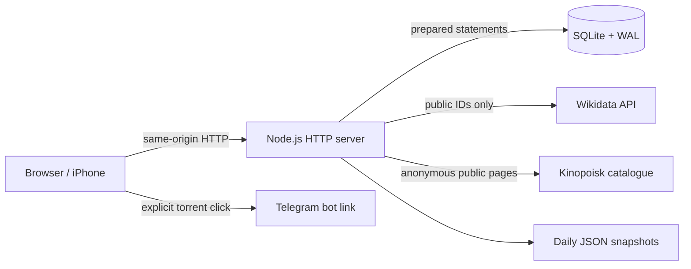

# Architecture and API

[← README](../README.md)

## One process, one database



The browser uses the same origin for assets and JSON endpoints. It keeps the current view in memory and refreshes the catalogue every 15 seconds while visible, as well as on focus. Sort preference is saved in browser `localStorage`; the catalogue itself lives in SQLite.

## Source map

| File | Responsibility |
| --- | --- |
| `server.mjs` | HTTP routing, SQLite initialization/migrations, same-origin writes, asset allowlist, export, snapshots. |
| `lib.mjs` | Record validation, row conversion, private-address checks. |
| `deployment.mjs` | Package version and a persistent deployment timestamp keyed to application file contents. |
| `metadata.mjs` | Kinopoisk URL parsing, exact Wikidata ID matching, title/date selection, cache, timeouts, concurrency limit. |
| `availability.mjs` | Exact-title Kinopoisk streaming-status parsing, persistent-cache interface, expiry, and in-flight deduplication. |
| `ratings.mjs`, `ratings-parser.mjs` | Exact-title Kinopoisk rating, viewer-review and description parsing, independent field refresh, persistent cache, and expiry. |
| `planned-refresh.mjs` | Single unwatched-title refresh job, deduplication, live eligibility checks, progress, cancellation and source backoff. |
| `kinopoisk-http.mjs` | Bounded public-page navigation and anonymous SSO, strict destination checks, temporary scoped cookies. |
| `public/app.js` | Rendering, add/edit/watch/trash actions, metadata form state, clipboard fallback. |
| `public/sort.mjs` | Planned/watched grouping and sort rules. |
| `public/torrent.mjs` | Plain-text queries and fixed Telegram destination. |
| `public/availability.mjs` | Streaming indicator labels, stale/unknown states, and safe official watch links. |
| `public/ratings.mjs` | Localized score/count formatting, score color tiers, missing values, and safe official card/review links. |
| `public/index.html`, `styles.css` | Page structure, dialogs, responsive visual design. |
| `seed.json` | Deliberately authored demo records for a fresh database. |
| `metadata-catalog.json` | Small reviewed public metadata examples; exact film/season keys. |
| `tests/` | Node.js unit and isolated HTTP integration tests. |

No frontend bundler, third-party database driver, runtime package, or external CDN script is required.

## Data model

Each record stores a title, note, premiere year, Kinopoisk URL, optional additional links, watch state, viewing date, mark timestamp, source order, creation/update timestamps, a version number, and a nullable deletion timestamp.

Russian and original titles currently share one display string: `Русское (Original)`. Imported records may retain `sourceText`; the public sample has it set to `null`.

- `watchedAt` is a calendar date chosen for the viewing.
- `markedAt` records when the watched mark was added. It is retained when editing an already-watched entry.
- `deletedAt` moves a record out of the active list and into Trash. Restoring preserves the watch fields.
- `version` increments on every mutation. Updates must provide the current version.
- `kinopoiskAvailabilityOverride` is `null`, `available`, or `unavailable`; its manual confirmation time is stored separately.
- `kinopoiskAvailability` is an enriched read field with `status`, `checkedAt`, `source`, `reason`, `watchUrl`, and `stale`. Automatic results live in a separate ID-keyed SQLite table. Refreshing them does not edit notes, watch history, record versions, or `updatedAt`.
- `kinopoiskStats` adds the primary card's rating, rating-vote count, positive/negative/neutral/total viewer-review counts, per-source check times, attempt time, and refresh status. `kinopoiskAdditionalStats` covers extra card links. These are enriched read fields backed by `kinopoisk_ratings`, not edits to the film record. Exports use schema version 4.

## HTTP API

All bodies and responses use JSON. Write requests must have `Content-Type: application/json` and an `Origin` equal to `http://<Host>`. This is a household app with no user authentication.

| Method | Path | Result |
| --- | --- | --- |
| `GET` | `/api/about` | `{ "version": "1.1.0", "deployedAt": "<ISO timestamp>" }` for the running deployment. |
| `GET` | `/api/films` | `{ "films": [...] }` active records. |
| `GET` | `/api/trash` | `{ "films": [...] }` soft-deleted records. |
| `GET` | `/api/export` | Downloadable snapshot with active records and Trash. |
| `POST` | `/api/films` | Create a record; returns `{ "film": ... }`, status 201. |
| `PATCH` | `/api/films/<id>` | Versioned edit/watch/delete/restore. |
| `POST` | `/api/kinopoisk/lookup` | Fetch form metadata; does not save a record. |
| `POST` | `/api/kinopoisk/availability` | Check `{ "url": "https://www.kinopoisk.ru/film/461939/", "refresh": false }`; returns `{ "availability": ... }`. Set `refresh: true` to bypass the result cache. |
| `POST` | `/api/kinopoisk/ratings` | The same URL/refresh request shape; returns `{ "stats": ... }` for the exact linked title. Saving a new or changed card also checks its rating and viewer reviews. |
| `GET` | `/api/kinopoisk/refresh-planned` | `{ "refresh": ... }` job state and progress. |
| `POST` | `/api/kinopoisk/refresh-planned` | Start one server-side pass; send `{}`. Returns the current job with status 202. Repeated starts while running return that same job. |
| `POST` | `/api/kinopoisk/refresh-planned/stop` | Send `{}` to request a stop after the in-flight lookup; completed writes are retained. |

Example lookup:

```json
{
  "url": "https://www.kinopoisk.ru/series/915196/",
  "season": 2
}
```

Example response fields:

```json
{
  "metadata": {
    "title": "Очень странные дела, 2 сезон (Stranger Things)",
    "releaseYear": 2017,
    "yearKind": "season-release",
    "warnings": []
  }
}
```

The actual response also includes separate title components, source information, and the normalized Kinopoisk URL.

Example versioned mutation:

```json
{
  "version": 3,
  "watched": true,
  "watchedAt": "2025-06-08"
}
```

Use `deleted: true` to move an entry to Trash, and `deleted: false` to restore it. There is no permanent-delete endpoint. A stale version returns **409**; an unexpected origin returns **403**.

## Release-year rules

Film release dates are selected from non-deprecated `P577` statements; a regional preferred rank does not hide an earlier known festival premiere. Production/inception properties are not a release-year fallback. Series use `P580`; selected seasons must resolve to an explicit season entity before their date is used.

An exact public Kinopoisk ID match is required. Ambiguous matches fail with a manual-entry message. Network lookups have a time limit, bounded responses, at most three concurrent requests, in-flight deduplication, and a capped one-day memory cache. Reviewed local entries take precedence and carry their verification date.

## Boundaries

Deployment metadata lives in `data/deployment.json`. On startup the server hashes `package.json`, root JavaScript modules, and public assets; catalogue data and file modification times are excluded. Identical files retain their original deployment time across restarts. Changed files or a package-version change create a new timestamp. Increment `package.json` for a new release and restart after copying the updated files. The header formats the persisted UTC timestamp in `Europe/Moscow`; runtime metadata is excluded from Git with the data directory.

Scores come from the matching `Film`/`TvSeries` entity in the public card's normalized Apollo state. The parser verifies the page ID, root query reference, entity ID, and type. SSR assignments are scanned as balanced JSON, with string escaping handled; source scripts are never executed. Only the Kinopoisk rating is read, not IMDb or critic ratings.

The same exact-ID card response provides `shortDescription`, with a `synopsis` fallback. Description extraction is independent of the rating schema and visibility. `kinopoiskStats` also exposes `description`, `descriptionSource` and `descriptionCheckedAt`; failed requests retain the last successful text and its time. Legacy cache entries without this field are upgraded on their next lookup. Text is normalized and limited to 3,000 characters before filling the form. The browser guards against URL changes and manual note edits during a lookup; it never renders source markup as HTML.

The manual refresh snapshots active unwatched IDs, then re-reads eligibility before each title and before filling a note. A conditional SQL update requires the same version and URL, `watched=0`, no Trash timestamp and an empty note; only that write advances the film version and `updatedAt`. Existing notes, title/year corrections and watch history are preserved. Additional card IDs are deduplicated across the pass; manual availability overrides skip their automatic streaming check. Automatic background sweeps yield while the manual pass runs. Each title's lookups are bounded; the queue is throttled, can be stopped, and pauses on a challenge or network error. In-memory job progress survives a browser reload, but is reset by a server restart.

Viewer sentiments come from a same-ID `/film/ID/reviews/` page, including for series. Its own back-link, the unique sentiment block, per-sentiment links, integer counters, and internal total must agree. Legacy positive/negative counts are not combined with modern nonzero review totals. An explicit exact-ID modern total of zero can establish zero sentiments when the legacy counters are absent.

Rating and review requests share an 8.5-second operation deadline; the HTTP helper further bounds each navigation to eight seconds/eight hops/three MiB. Two logical rating lookups can run concurrently. Successful field values survive unrelated source failures, with their original field timestamps retained. Complete results expire after a day; partial/failed attempts after 15 minutes. Existing active and trashed titles and their additional links are covered by throttled sweeps.

Availability requires a matching numeric title ID and matching HD UUID in the public page's `__NEXT_DATA__`. Only the current-region/current-device `isWatchable` field and the corresponding `WATCHABLE`/`UNWATCHABLE` enum are accepted; missing, contradictory, future-announced, or unfamiliar values remain unknown. Requests have an eight-second deadline, a redirect limit, a three-MiB response bound, and two concurrent lookups. Confirmed results expire after 24 hours; unknowns after 15 minutes. Background work is throttled and pauses the current pass on challenges or network errors. Manual overrides take precedence.

The HTTP client follows only fixed official hosts and the ordinary anonymous SSO auto-submit flow. It validates the destination, return path, and anonymous result without executing JavaScript. Cookies are scoped to their origin/domain/path and discarded after each lookup. No user account/session or browser profile is used. This is a conservative public-page integration, not a supported Kinopoisk API contract.

Mutations validate dates, years, lengths, URL hosts, and record versions. Static assets are served from an explicit allowlist; database files are not static assets. Content Security Policy disallows remote scripts and the UI renders titles/notes as text.

Private-address and host checks are intentionally narrow. They are not a replacement for authentication: a reverse proxy can make remote clients appear local. See [self-hosting](self-hosting.md) before changing exposure.
